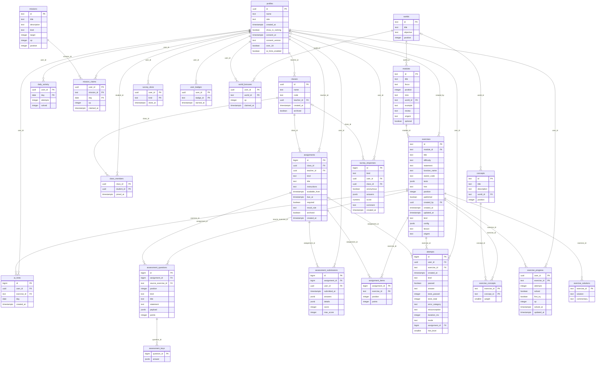

# Diagrama entidade-relacionamento

> Gerado automaticamente das migrations por `npm run docs:er` (não edite à mão). Colunas marcadas PK (chave primária) e FK (chave estrangeira). Só as tabelas do esquema `public`; as contas de login ficam em `auth.users` (Supabase Auth) e se ligam a `profiles`.

## Tabelas

Total: 24 tabelas e 35 relacionamentos.
