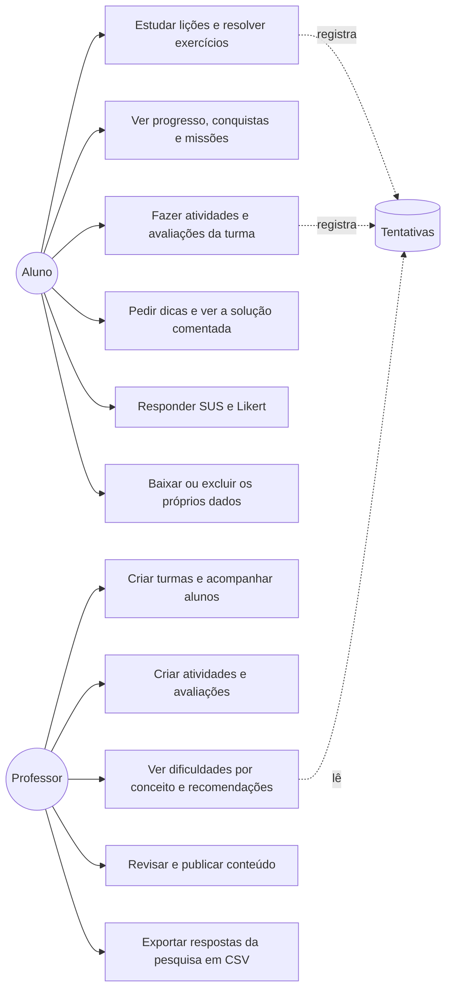
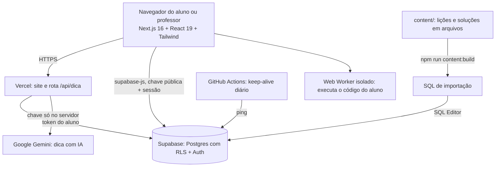

# Orientações para o texto do TCC

Material de apoio para escrever o trabalho. Tudo aqui descreve o que **existe** no repositório (nada foi inventado); onde
algo não foi feito, está dito em "Limitações".

## 1. Visão geral
Plataforma web gamificada para o ensino de lógica de programação (JavaScript), com sete mundos de conteúdo, exercícios de sete
tipos, modo aprendizado (liberação por domínio), atividades e avaliações para turmas e um painel que mostra ao professor quais
conceitos os alunos ainda não compreenderam. Orçamento: R$ 0 (Supabase Free, Vercel Hobby, GitHub Actions, Gemini gratuito).

## 2. Requisitos
### Funcionais
| Código | Requisito |
| --- | --- |
| RF01 | Cadastro e login com perfis de aluno e professor; termo de consentimento. |
| RF02 | Currículo em 7 mundos, cada um com lições em 7 passos (introdução, explicação, exemplo, interpretação, prática, desafio, revisão). |
| RF03 | Exercícios de código, múltipla escolha, lacunas, interpretação, ordenação, corrigir o erro e desafio, com correção automática. |
| RF04 | Modo aprendizado: a lição seguinte libera com 70% da anterior; modo prática libera tudo; professor nunca é bloqueado. |
| RF05 | Gamificação: XP, níveis, medalhas, missões diárias, sequência de dias e ranking opcional da turma. |
| RF06 | Dicas em níveis (professor, conceito e IA) e solução comentada depois de acertar. |
| RF07 | Turmas com código de entrada, arquivamento e perfil do aluno para o professor. |
| RF08 | Atividades para casa e avaliações com nota corrigidas no banco, com acompanhamento das entregas. |
| RF09 | Painel de dificuldades por conceito, erros recorrentes, recomendações e atividade de reforço. |
| RF10 | Questionários SUS e Likert (anônimos ou identificados) com exportação em CSV. |
| RF11 | Exportação e exclusão dos dados pessoais (LGPD). |
| RF12 | Conteúdo em arquivos versionados, revisado pelo professor antes de publicar. |
### Não funcionais
| Código | Requisito | Como é atendido |
| --- | --- | --- |
| RNF01 | Segurança | RLS em todas as tabelas, funções SECURITY DEFINER, gabaritos em tabela ilegível ao aluno, executor isolado. |
| RNF02 | Acessibilidade | Testes axe em 4 combinações (celular/computador, claro/escuro) e navegação por teclado. |
| RNF03 | Privacidade | Consentimento, exclusão de conta, dica com IA opcional, dados agregados com mínimo de 5. |
| RNF04 | Custo zero | Planos gratuitos; `ping` diário evita a pausa por inatividade. |
| RNF05 | Desempenho | Relatório de conceitos em ~300 ms com 40 mil tentativas (ver `docs/limites-do-plano-gratuito.md`). |

## 3. Casos de uso

## 4. Diagrama entidade-relacionamento
Gerado das migrations: `docs/tcc/diagrama-er.md` (atualize com `npm run docs:er`).

## 5. Arquitetura

Decisões: correção de código no navegador (custo zero e sem servidor de execução); correção de avaliações no banco (nota confiável);
regras de segurança no banco (RLS) e não só na interface.

## 6. Segurança (o que mostrar)
- **RLS** ligada em todas as tabelas e **nenhuma permissão para visitantes** (teste `auditoria.test.ts`).
- **Escrita só por funções:** tentativas, missões, bônus e avaliações são gravadas por funções SECURITY DEFINER que validam tudo.
- **XP calculado pelo banco**, ignorando o valor enviado pelo navegador.
- **Avaliações:** gabarito em `assessment_keys` (sem leitura para o aluno), entrega única e prazo conferido no servidor.
- **Executor de código:** Web Worker sem rede, DOM, `importScripts` nem `import()`, com limite de 2 s, de linhas de saída e sem `postMessage` forjado
  (testes `tipos-novos` e `seguranca-do-executor`).
- **Chaves:** só a chave pública no navegador; a do Gemini, só no servidor; `.env.local` fora do git.
- **LGPD:** ver `docs/privacidade-e-lgpd.md`.

## 7. Testes (o que mostrar)
- Testes de unidade e de banco (Vitest + PGlite): lógica de XP, níveis, liberação, relatório de conceitos (SQL = função pura), SUS, conteúdo e migrations.
- Testes de ponta a ponta (Playwright) com backend simulado, em computador e celular, com axe.
- Validação do conteúdo: cada solução de referência passa nos próprios testes e o código inicial reprova.
- Relatório de testes: `docs/relatorio-final.md`.

## 8. Avaliação com os alunos
1. Cada aluno responde ao **SUS** (usabilidade) e ao **Likert** (experiência de aprendizagem) na própria plataforma (Perfil → "Sua opinião"), de forma anônima ou identificada.
2. O professor baixa o **CSV** em Professor → Pesquisa. Colunas: id, data, questionário, modo, turma, nome (só identificadas), pontuação SUS, q1..q10, comentário.
3. **Pontuação SUS:** itens ímpares valem (resposta − 1), pares valem (5 − resposta); soma × 2,5 (0 a 100). Referência da literatura: média 68; acima de ~73 é considerada boa.
4. **Likert:** tratar cada afirmação por mediana e distribuição (a escala é ordinal); a média por item aparece no painel apenas como apoio.
5. **Dica com IA:** o painel compara, de forma agregada, quem usou e quem não usou (taxa de acerto, tentativas, exercícios resolvidos). É um indício, não prova de causa; descreva as variáveis que podem confundir (quem pede dica pode ser quem tem mais dificuldade).
6. Registrar no texto: número de participantes, período, como foi o consentimento (e a autorização dos responsáveis, se houver menores), e o parecer do CEP, se aplicável.

## 9. Limitações conhecidas
- Código dos alunos é corrigido **no navegador**: serve para estudo, não para provas com nota. Avaliações com nota só usam tipos corrigidos no banco.
- O banco aceita o "resolvido" informado pelo navegador nos exercícios de código (XP é calculado no servidor, mas o resultado do teste não é verificado lá).
- Plano gratuito do Supabase **pausa por inatividade** (mitigado pelo `ping`) e tem 500 MB.
- Questões de avaliação vêm do catálogo: quem já praticou pode lembrar a resposta.
- Conteúdo escrito por IA e revisado pelo professor: **a revisão é etapa obrigatória** antes de publicar (`docs/revisao/`).
- Dados de uso reais ainda não existem: painéis e testes foram validados com dados simulados.
- Sem log de auditoria de acessos e sem notificações por e-mail.

## 10. Trabalhos futuros
Correção de código no servidor para avaliações; mais tipos de questão em provas; recomendação adaptativa de exercícios por conceito;
visualização do código do aluno lado a lado com a solução; versão offline; tradução da interface.
